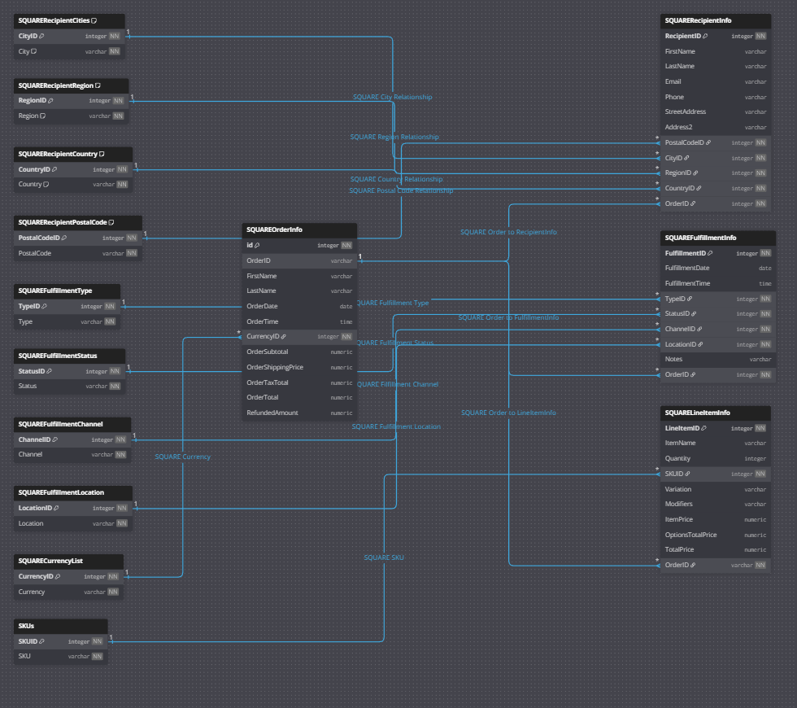
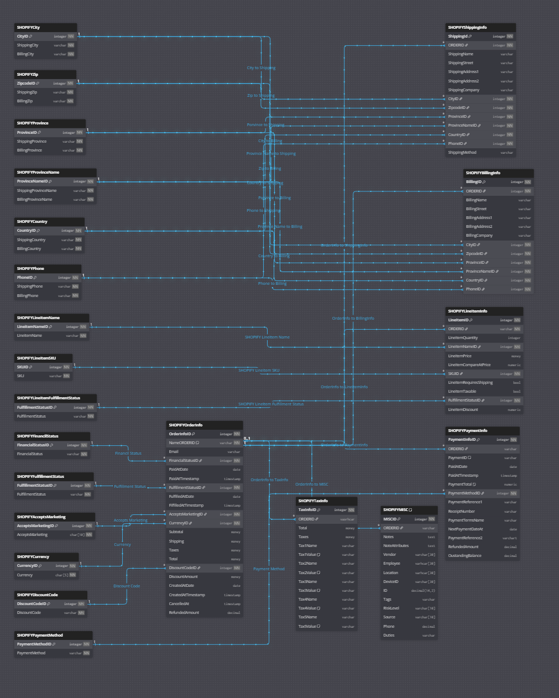

# Over View for Sales Database

## Square data tables



## Shopify data tables


## DBML

### Rough Template 12-18-2025
```dbml


//  █████  █████  █     █   ███   █████  █████
//  █      █   █  █     █  █   █  █   █  █
//  █████  █   █  █     █  █████  █████  █████
//      █  █  ██  █     █  █   █  █  █   █
//  █████  █████   █████   █   █  █   █  █████

Table SQUARERecipientInfo [headercolor: #177a5e] {
	RecipientID integer [ pk, increment, not null, unique ]
	FirstName varchar
	LastName varchar
	Email varchar
	Phone varchar
	StreetAddress varchar
	Address2 varchar
	PostalCodeID integer [ not null ]
	CityID integer [ not null ]
	RegionID integer [ not null ]
	CountryID integer [ not null ]
	OrderID integer [ not null ]
}

Table SQUARERecipientCities [headercolor: #177a5e] {
	CityID integer [ pk, increment, not null, unique ]
	City varchar [ not null, note: 'Before loading the data make sure that all entries have the same cap sensitive structure' ]

	Note: '''This table will hold a list of all cities that have been delivered to. 

(eventually want to add longitude and latitude to this)'''
}

Table SQUARERecipientRegion [headercolor: #177a5e] {
	RegionID integer [ pk, increment, not null, unique ]
	Region varchar [ not null, note: 'When processing the data make sure to normalize all states in the US to their 2 letter abbreviation' ]

	Note: 'This will hold the states for shipments within the united states but will also hold regions around the world for location outside of the US.'
}

Table SQUARERecipientCountry [headercolor: #177a5e] {
	CountryID integer [ pk, increment, not null, unique ]
	Country varchar [ not null, note: 'Country should be in the country code, but do a double check to make sure. ' ]

	Note: 'This table will hold all of the information relating to the countries that have been shipped to.'
}

Table SQUARERecipientPostalCode [headercolor: #177a5e] {
	PostalCodeID integer [ pk, increment, not null, unique ]
	PostalCode varchar [ not null ]

	Note: 'This will hold all of the postal codes that have been shipped to'
}

Table SQUAREFulfillmentInfo [headercolor: #c9a30a] {
	FulfillmentID integer [ pk, increment, not null, unique ]
	FulfillmentDate date
	FulfillmentTime time
	TypeID integer [ not null ]
	StatusID integer [ not null ]
	ChannelID integer [ not null ]
	LocationID integer [ not null ]
	Notes varchar
	OrderID integer [ not null ]
}

Table SQUAREFulfillmentType [headercolor: #c9a30a] {
	TypeID integer [ pk, increment, not null, unique ]
	Type varchar [ not null ]
}

Table SQUAREFulfillmentStatus [headercolor: #c9a30a] {
	StatusID integer [ pk, increment, not null, unique ]
	Status varchar [ not null ]
}

Table SQUAREFulfillmentChannel [headercolor: #c9a30a] {
	ChannelID integer [ pk, increment, not null, unique ]
	Channel varchar [ not null ]
}

Table SQUAREFulfillmentLocation [headercolor: #c9a30a] {
	LocationID integer [ pk, increment, not null, unique ]
	Location varchar [ not null ]
}

Table SQUAREOrderInfo [headercolor: #4a177a] {
	id integer [ pk, increment, not null, unique ]
	OrderID varchar
	FirstName varchar
	LastName varchar
	OrderDate date
	OrderTime time
	CurrencyID integer [ not null ]
	OrderSubtotal numeric
	OrderShippingPrice numeric
	OrderTaxTotal numeric
	OrderTotal numeric
	RefundedAmount numeric
}

Table SQUARECurrencyList [headercolor: #4a177a] {
	CurrencyID integer [ pk, increment, not null, unique ]
	Currency varchar [ not null ]
}

Table SQUARELineItemInfo [headercolor: #175e7a] {
	LineItemID integer [ pk, increment, not null, unique ]
	ItemName varchar
	Quantity integer
	SKUID integer [ not null ]
	Variation varchar
	Modifiers varchar
	ItemPrice numeric
	OptionsTotalPrice numeric
	TotalPrice numeric
	OrderID varchar [ not null ]
}

Table SKUs [headercolor: #175e7a] {
  SKUID integer [pk, increment, not null, unique]
  SKU varchar [ not null ]
}

// Initial square refrences 12-16-2025

Ref "SQUARE City Relationship" {
	SQUARERecipientCities.CityID < SQUARERecipientInfo.CityID [ delete: no action, update: cascade ]
}


Ref "SQUARE Region Relationship" {
	SQUARERecipientInfo.RegionID > SQUARERecipientRegion.RegionID [ delete: no action, update: no action ]
}

Ref "SQUARE Postal Code Relationship" {
	SQUARERecipientPostalCode.PostalCodeID < SQUARERecipientInfo.PostalCodeID [ delete: no action, update: no action ]
}

Ref "SQUARE Country Relationship" {
	SQUARERecipientInfo.CountryID > SQUARERecipientCountry.CountryID [ delete: no action, update: no action ]
}

Ref "SQUARE Fulfillment Type" {
	SQUAREFulfillmentType.TypeID < SQUAREFulfillmentInfo.TypeID [ delete: no action, update: no action ]
}

Ref "SQUARE Fulfillment Status" {
	SQUAREFulfillmentInfo.StatusID > SQUAREFulfillmentStatus.StatusID [ delete: no action, update: no action ]
}

Ref "SQUARE Filfillment Channel" {
	SQUAREFulfillmentChannel.ChannelID < SQUAREFulfillmentInfo.ChannelID [ delete: no action, update: no action ]
}

Ref "SQUARE Fulfillment Location" {
	SQUAREFulfillmentInfo.LocationID > SQUAREFulfillmentLocation.LocationID [ delete: no action, update: no action ]
}

Ref "SQUARE Currency" {
	SQUAREOrderInfo.CurrencyID > SQUARECurrencyList.CurrencyID [ delete: no action, update: no action ]
}

Ref "SQUARE SKU"{
  SQUARELineItemInfo.SKUID > SKUs.SKUID [ delete: no action, update: no action]
}

ref "SQUARE Order to FulfillmentInfo" {
  SQUAREFulfillmentInfo.OrderID > SQUAREOrderInfo.OrderID [ delete: no action, update: no action]
}

ref "SQUARE Order to LineItemInfo" {
  SQUARELineItemInfo.OrderID > SQUAREOrderInfo.OrderID [ delete: no action, update: no action]
}

ref "SQUARE Order to RecipientInfo" {
  SQUARERecipientInfo.OrderID > SQUAREOrderInfo.OrderID [ delete: no action, update: no action]
}


//  █████   █   █   █████   █████   █████   █████   █   █
//  █       █   █   █   █   █   █     █     █        █ █
//  ████    █████   █   █   █████     █     ████      █
//      █   █   █   █   █   █         █     █         █
//  █████   █   █   █████   █       █████   █         █


table SHOPIFYShippingInfo [headercolor: #FFFFFF]{
  ShippingId integer [ pk, increment, not null, unique ]
  ORDERID integer [ not null ]
  ShippingName varchar
  ShippingStreet varchar 
  ShippingAddress1 varchar
  ShippingAddress2 varchar
  ShippingCompany varchar
  CityID integer [ not null ]
  ZipcodeID integer [ not null ]
  ProvinceID integer [ not null ]
  ProvinceNameID integer [ not null ]
  CountryID integer [ not null ]
  PhoneID integer [ not null ]
  ShippingMethod  varchar 
}

table SHOPIFYBillingInfo [headercolor: #FFFFFF] {
  BillingID integer [ pk, increment, not null, unique ]
  ORDERID integer [ not null ]
  BillingName varchar
  BillingStreet varchar 
  BillingAddress1 varchar
  BillingAddress2 varchar
  BillingCompany varchar
  CityID integer [ not null ]
  ZipcodeID integer [ not null ]
  ProvinceID integer [ not null ]
  ProvinceNameID integer [ not null ]
  CountryID integer [ not null ]
  PhoneID integer [ not null ]
}


table SHOPIFYCity {
  CityID integer [ pk, increment, not null, unique ]
  ShippingCity varchar [ not null ]
  BillingCity varchar [ not null ]
}

table SHOPIFYZip {
  ZipcodeID integer [ pk, increment, not null, unique ]
  ShippingZip varchar [ not null ]
  BillingZip varchar [ not null ]
}

table SHOPIFYProvince {
  ProvinceID integer [ pk, increment, not null, unique ]
  ShippingProvince varchar [ not null ]
  BillingProvince varchar [ not null ]
}

table SHOPIFYProvinceName {
  ProvinceNameID integer [ pk, increment, not null, unique ]
  ShippingProvinceName varchar [ not null ]
  BillingProvinceName varchar [ not null ]
}

table SHOPIFYCountry {
  CountryID integer [ pk, increment, not null, unique ]
  ShippingCountry varchar [ not null ]
  BillingCountry varchar [ not null ]
}

table SHOPIFYPhone {
  PhoneID integer [ pk, increment, not null, unique ]
  ShippingPhone varchar [ not null ]
  BillingPhone varchar [ not null ]
}

table SHOPIFYLineItemInfo [headercolor: #FFFFFF] {
  LineItemID integer [ pk, increment, not null, unique ]
  ORDERID varchar [ not null ]
  LineitemQuantity integer
  LineitemNameID integer [ not null ]
  LineitemPrice money 
  LineitemCompareAtPrice numeric
  SKUID integer [ not null ]
  LineitemRequiresShipping bool
  LineitemTaxable bool
  FulfillmentStatusID integer [ not null ]
  LineitemDiscount numeric
}

table SHOPIFYLineItemName {
  LineitemNameID integer [ pk, increment, not null, unique ]
  LineitemName varchar [ not null ]
}

table SHOPIFYLineItemSKU {
  SKUID integer [ pk, increment, not null, unique ]
  SKU varchar [ not null ]
}

table SHOPIFYLineItemFulfillmentStatus {
  FulfillmentStatusID integer [ pk, increment, not null, unique ]
  FulfillmentStatus varchar [ not null ]
}


table SHOPIFYOrderInfo [headercolor: #FFFFFF] {
  OrderInfoID integer [ pk, increment, not null, unique ]
  NameORDERID varchar [ not null, note: 'come back to this' ]
  Email varchar 
  FinancialStatusID integer [ not null ]
  PaidAtDate date
  PaidAtTimestamp timestamp
  FulfillmentStatusID integer [ not null ]
  FulfilledAtDate date
  FilfilledAtTimestamp timestamp
  AcceptsMarketingID integer [ not null ]
  CurrencyID integer [ not null ]
  Subtotal money
  Shipping money
  Taxes money
  Total money
  DiscountCodeID integer [ not null ]
  DiscountAmount money
  CreatedAtDate date
  CreatedAtTimestamp timestamp
  CancelledAt timestamp
  RefundedAmount decimal
}

table SHOPIFYFinancilStatus {
  FinancialStatusID integer [ pk, increment, not null, unique ]
  FinancialStatus varchar [ not null ]

}

table SHOPIFYFulfillmentStatus {
  FulfillmentStatusID integer [ pk, increment, not null, unique ]
  FulfillmentStatus varchar [ not null ]

}

table SHOPIFYAcceptsMarketing {
  AcceptsMarketingID integer [ pk, increment, not null, unique ]
  AcceptsMarketing char[10] [ not null ]

}

table SHOPIFYCurrency {
  CurrencyID integer [ pk, increment, not null, unique ]
  Currency char[5] [ not null ]
}

table SHOPIFYDiscountCode {
  DiscountCodeID integer [ pk, increment, not null, unique ]
  DiscountCode varchar [ not null ]

}

table SHOPIFYPaymentInfo [headercolor: #FFFFFF] {
  PaymentInfoID integer [ pk, increment, not null, unique ]
  ORDERID varchar
  PaymentID varchar [ note: 'this is not a key but something tht is used on shopifys end']
  PaidAtDate date
  PaidAtTimestamp timestamp
  PaymentTotal numeric  [note: 'This will be the totl price of the order' ]
  PaymentMethodID integer [ not null ]
  PaymentReference1 varchar
  ReceiptNumber varchar
  PaymentTermsName varchar
  NextPaymentDateAt date
  PaymentReference2 varchart
  RefundedAmount decimal
  OustandingBalance decimal
}

table SHOPIFYPaymentMethod {
  PaymentMethodID integer [ pk, increment, not null, unique ]
  PaymentMethod varchar [ not null ]
}

table SHOPIFYTaxInfo [headercolor: #FFFFFF] {
  TaxInfoID integer [ pk, increment, not null, unique ]
  ORDERID vasrhcar
  Total money
  Taxes money
  Tax1Name varchar
  Tax1Value varchar [ note: 'come back to this as it may become a deciaml through cleaning' ]
  Tax2Name varchar
  Tax2Value varchar [ note: 'come back to this as it may become a deciaml through cleaning' ]
  Tax3Name varchar
  Tax3Value varchar [ note: 'come back to this as it may become a deciaml through cleaning' ] 
  Tax4Name varchar
  Tax4Value varchar [ note: 'come back to this as it may become a deciaml through cleaning' ]
  Tax5Name varchar 
  Tax5Value varchar [ note: 'come back to this as it may become a deciaml through cleaning' ]
}

table SHOPIFYMISC {
  MISCID integer [ pk, increment, not null, unique ]
  ORDERID varchar
  Notes text
  NoteAttributes text
  Vendor varchar[30]
  Employee varhcar[30]
  Location varhcar[30]
  DeviceID varchar[30]
  ID decimal (14, 2)
  Tags varchar
  RiskLevel varchar[10]
  Source varchar[10]
  Phone decimal
  Duties varchar

  note: 'This table is used to hold the left over information that ws not added to other tables and is not very usful but should still be kept track of.'
}

// Initial shopify refrences 12-16-2025


ref "SHOPIFY LineItem Name" {
  SHOPIFYLineItemName.LineitemNameID < SHOPIFYLineItemInfo.LineitemNameID [ delete: no action, update: cascade ]
}

ref "SHOPIFY Lineitem SKU" {
  SHOPIFYLineItemSKU.SKUID < SHOPIFYLineItemInfo.SKUID [ delete: no action, update: cascade ]
}

ref "SHOPIFY LineItem Fulfillment Status" {
  SHOPIFYLineItemFulfillmentStatus.FulfillmentStatusID < SHOPIFYLineItemInfo.FulfillmentStatusID [delete: no action, update: cascade]
}

ref "Payment Method" {
  SHOPIFYPaymentMethod.PaymentMethodID < SHOPIFYPaymentInfo.PaymentMethodID [ delete: no action, update: cascade]
}

ref "Accepts Marketing" {
  SHOPIFYAcceptsMarketing.AcceptsMarketingID < SHOPIFYOrderInfo.AcceptsMarketingID [ delete: no action, update: cascade ]
}

ref "Financil Status" {
  SHOPIFYFinancilStatus.FinancialStatusID < SHOPIFYOrderInfo.FinancialStatusID [ delete: no action, update: cascade ]
}

ref "Fulfillment Status" {
  SHOPIFYFulfillmentStatus.FulfillmentStatusID < SHOPIFYOrderInfo.FulfillmentStatusID [ delete: no action, update: cascade ]
}

ref "Currency" {
  SHOPIFYCurrency.CurrencyID < SHOPIFYOrderInfo.CurrencyID [ delete: no action, update: cascade ]
}

ref "Discount Code" {
  SHOPIFYDiscountCode.DiscountCodeID < SHOPIFYOrderInfo.DiscountCodeID [ delete: no action, update: cascade ]
}
ref "Porvince to Shipping" {
  SHOPIFYProvince.ProvinceID < SHOPIFYShippingInfo.ProvinceID [ delete: no action, update: cascade ]
}

ref "Porvince to Billing" {
  SHOPIFYProvince.ProvinceID < SHOPIFYBillingInfo.ProvinceID [ delete: no action, update: cascade ]
}

ref "Province Name to Shipping" {
  SHOPIFYProvinceName.ProvinceNameID < SHOPIFYShippingInfo.ProvinceNameID [ delete: no action, update: cascade ]
}

ref "Province Name to Billing" {
  SHOPIFYProvinceName.ProvinceNameID < SHOPIFYBillingInfo.ProvinceNameID [ delete: no action, update: cascade ]
}

ref "Zip to Shipping" {
  SHOPIFYZip.ZipcodeID < SHOPIFYShippingInfo.ZipcodeID [ delete: no action, update: cascade ]
}

ref "Zip to Billing" {
  SHOPIFYZip.ZipcodeID < SHOPIFYBillingInfo.ZipcodeID [ delete: no action, update: cascade ]
}

ref "Country to Shipping" {
  SHOPIFYCountry.CountryID < SHOPIFYShippingInfo.CountryID [ delete: no action, update: cascade ]
}

ref "Country to Billing" {
  SHOPIFYCountry.CountryID < SHOPIFYBillingInfo.CountryID [ delete: no action, update: cascade ]
}

ref "City to Shipping" {
  SHOPIFYCity.CityID < SHOPIFYShippingInfo.CityID [ delete: no action, update: cascade ]
}

ref "City to Billing" {
  SHOPIFYCity.CityID < SHOPIFYBillingInfo.CityID [ delete: no action, update: cascade ]
}

ref "Phone to Shipping" {
  SHOPIFYPhone.PhoneID < SHOPIFYShippingInfo.PhoneID [ delete: no action, update: cascade ]
}

ref "Phone to Billing" {
  SHOPIFYPhone.PhoneID < SHOPIFYBillingInfo.PhoneID [ delete: no action, update: cascade ]
}


// Shopify order name to all IDs
ref "OrderInfo to Paymentinfo" {
  SHOPIFYOrderInfo.NameORDERID < SHOPIFYPaymentInfo.ORDERID
}

ref "OrderInfo to LineItemInfo" {
  SHOPIFYOrderInfo.NameORDERID < SHOPIFYLineItemInfo.ORDERID
}

ref "OrderInfo to ShippingInfo" {
  SHOPIFYOrderInfo.NameORDERID < SHOPIFYShippingInfo.ORDERID
}

ref "OrderInfo to BillingInfo" {
  SHOPIFYOrderInfo.NameORDERID < SHOPIFYBillingInfo.ORDERID
}

ref "OrderInfo to TaxInfo" {
  SHOPIFYOrderInfo.NameORDERID < SHOPIFYTaxInfo.ORDERID
}

ref "OrderInfo to MISC" {
  SHOPIFYOrderInfo.NameORDERID < SHOPIFYMISC.ORDERID
}

//  █████   █████   █████   █████
//  █       █   █   █   █   █
//  █       █   █   █████   █████
//  █       █   █   █  █    █
//  █████   █████   █   █   █████


```