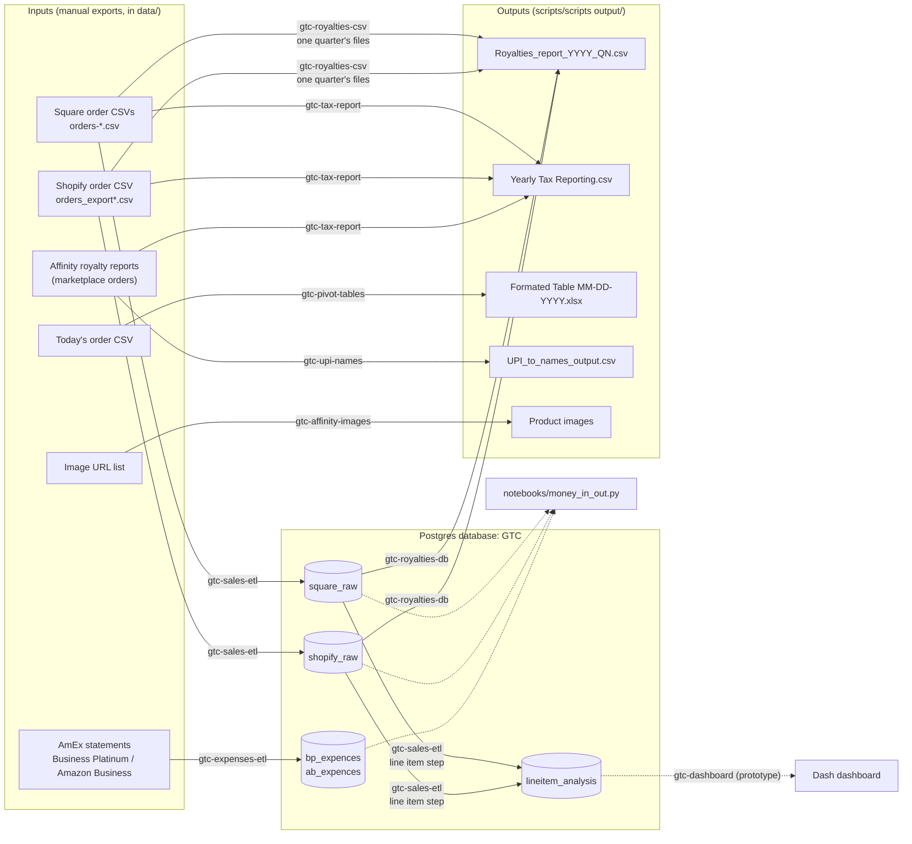

# How GTC_code fits together

GTC_code is a set of small tools for Game Time Couture's back office. They turn
**order exports** (Square online store, Shopify, Affinity marketplace) and
**AmEx card statements** into **reports** (quarterly royalties, yearly sales
tax, daily pivot tables) and a **Postgres database** for analysis.

Nothing runs on a schedule. Every tool is a command you run by hand after
dropping the latest export files into a folder under `data/`.

## Data flow



There are two ways to build the royalty report:

* **`gtc-royalties-csv`** reads one quarter's Square and Shopify exports directly.
  This is the one that has been used every quarter, and it works.
* **`gtc-royalties-db`** queries the database filled by the Sales ETL. This was
  meant to replace the CSV route; it stopped working when the Sales ETL broke
  and now works again. The two differ in a couple of filters (see
  [AUDIT.md](AUDIT.md#open-questions)).

## The projects

| Folder | Python package | Command(s) | What it is |
|---|---|---|---|
| `gtc_common/` | `gtc_common` | `gtc-db-migrate`, `gtc-db-seed` | Shared code: `.env` loading, logging, Postgres access, order-cleaning helpers, regex builders, DB schema |
| `Data-Pipelines/Sales_ETL/` | `Sales_ETL` | `gtc-sales-etl` | Square + Shopify exports → `square_raw`, `shopify_raw` → `lineitem_analysis` |
| `Data-Pipelines/Expences_ETL/` | `expenses_etl` | `gtc-expenses-etl` | AmEx statements → `bp_expences`, `ab_expences` |
| `scripts/src/` | `gtc_reports` | `gtc-royalties-csv`, `gtc-royalties-db`, `gtc-tax-report`, `gtc-upi-names`, `gtc-affinity-images` | Royalty, tax and Affinity helper reports |
| `GTC-Formated-Privot-Tables/src/` | `gtc_pivot_tables` | `gtc-pivot-tables` | Daily order CSV → Excel workbook with three pivot tables |
| `Analysis-Bashboard/src/` | `analysis_bashboard` | `gtc-dashboard` | Dash dashboard: **layout prototype only**, plus chart builders |
| `Analysis-Bashboard/notebooks/` | — | `python …/money_in_out.py` | Scratch analysis: sales vs expenses over time |
| `shopify-graphql-retrieve-orders/` | Node | `npm run check / orders / shop` | Test scripts for the Shopify Admin GraphQL API. Nothing else uses them yet |
| `gtc-graphql-api/` | Node | `shopify app dev` | Stock Shopify embedded-app template (React Router + Prisma). Not used by anything |

Folder names keep their original spelling (`Bashboard`, `Privot`, `Expences`)
so existing paths and habits keep working; the Python package names are clean.

## How the pieces connect

* **One settings file.** Every project reads the repo-root `.env` through
  `gtc_common.env` (Python) or `load-root-env.cjs` (Node). See [ENV.md](ENV.md).
* **One install.** `pip install -e .` installs every Python package and the
  `gtc-*` commands from `pyproject.toml`. No `sys.path` tricks.
* **One database.** Local Postgres, database `GTC`. Tables are created by
  `gtc-db-migrate` from `gtc_common/schema/*.sql`. See [DATABASE.md](DATABASE.md).
* **Shared cleaning code.** `gtc_common/orders.py` holds the Square/Shopify
  helpers (per-order fill, cancelled-order removal, phone formatting, quarter
  dates) used by the ETL and the reports, so a fix lands everywhere at once.
* **Logs.** Each command writes `logs/<command>.log` (folder set by `LOG_DIR`).
  The two Sales ETL steps also write a shared `logs/sales_master.log`.

## Repository layout

```
GTC_code/
├── .env / .env.example        settings (real / template)
├── pyproject.toml             Python packages, dependencies, gtc-* commands
├── load-root-env.cjs          .env loader for the Node projects
├── gtc_common/                shared Python code + schema/*.sql
├── Data-Pipelines/
│   ├── Sales_ETL/             run.py, Pipelines/raw_orders, Pipelines/line_item_analysis, sql/, assets/
│   └── Expences_ETL/          pipeline.py
├── scripts/
│   ├── src/                   gtc_reports package (royalties, tax, UPI, images) + sql/
│   ├── scripts input/         Images_urls.txt
│   └── scripts output/        generated reports (git-ignored)
├── GTC-Formated-Privot-Tables/src/   gtc_pivot_tables package + assets/regex_patterns.json
├── Analysis-Bashboard/        src/ (dashboard), notebooks/, dashboard-brief.md
├── shopify-graphql-retrieve-orders/src/   Node test scripts
├── gtc-graphql-api/src/       Shopify app template
├── tests/                     pytest suite
├── docs/                      this documentation
├── data/                      input exports (git-ignored)
├── logs/                      log files (git-ignored)
└── Database/                  old SQLite files + old MySQL queries (git-ignored, retired)
```
